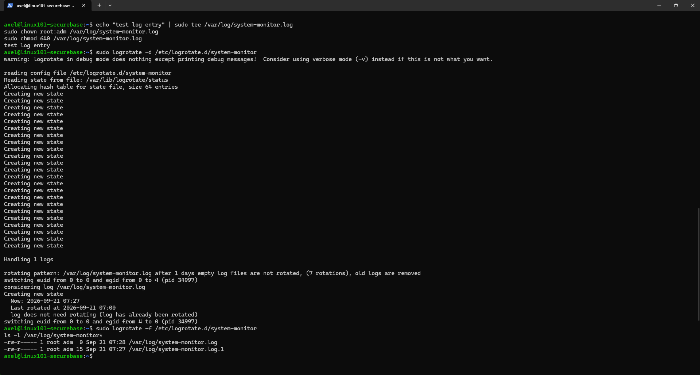
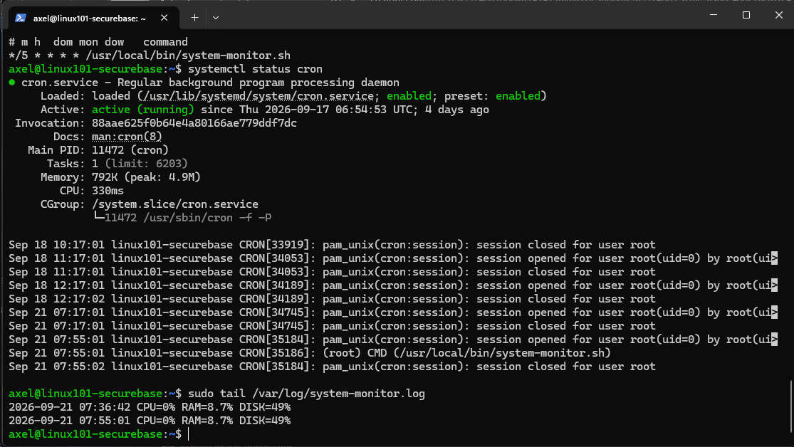
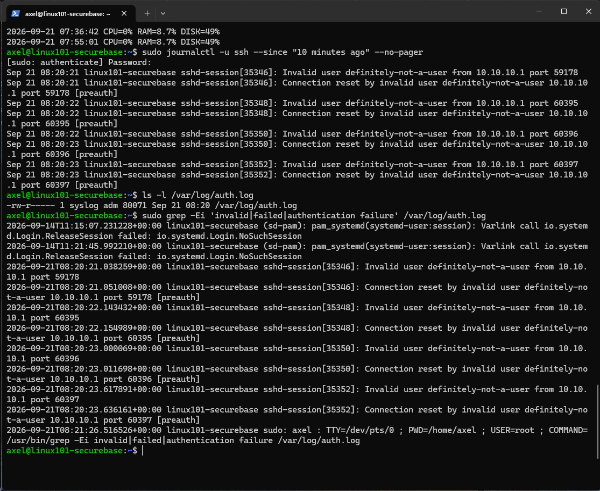
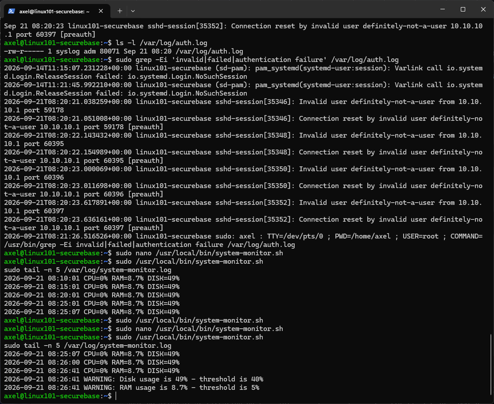

# Modul 5: Monitorering og logging

## Formål

Formålet med modulet er at kunne opdage unormal aktivitet, ressourceproblemer og sikkerhedsrelaterede hændelser på Linux-serveren.

Der er derfor opsat:

- logrotation for monitoreringsloggen
- et Bash-script til overvågning af CPU, RAM og disk
- periodisk kørsel af scriptet via cron
- kontrol af mislykkede SSH-loginforsøg via `journalctl` og `/var/log/auth.log`
- thresholds for højt disk- og RAM-forbrug

## Udførte opgaver

### 1. Logrotation

Monitoreringsloggen ligger i:

```text
/var/log/system-monitor.log
```

Der blev oprettet en logrotate-konfiguration:

```text
/etc/logrotate.d/system-monitor
```

Konfiguration:

```conf
/var/log/system-monitor.log {
    su root adm
    daily
    rotate 7
    compress
    delaycompress
    missingok
    notifempty
    create 0640 root adm
}
```

Valgene betyder:

- `daily` — loggen vurderes til rotation dagligt
- `rotate 7` — syv ældre logfiler beholdes
- `compress` — ældre logs komprimeres
- `delaycompress` — den nyeste roterede log komprimeres først ved næste rotation
- `missingok` — manglende logfil giver ikke fejl
- `notifempty` — tomme logs roteres ikke
- `create 0640 root adm` — ny log oprettes med begrænsede rettigheder
- `su root adm` — logrotate udfører rotationen med den angivne bruger og gruppe

Konfigurationen blev først testet med:

```bash
sudo logrotate -d /etc/logrotate.d/system-monitor
```

Derefter blev en rotation tvunget for at kontrollere resultatet:

```bash
sudo logrotate -f /etc/logrotate.d/system-monitor
ls -l /var/log/system-monitor*
```

Resultatet viste både den aktive log og den roterede log:

```text
/var/log/system-monitor.log
/var/log/system-monitor.log.1
```

### 2. Monitoreringsscript

Scriptet ligger i:

```text
/usr/local/bin/system-monitor.sh
```

Scriptet logger:

- CPU-forbrug
- RAM-forbrug
- diskforbrug for `/`
- tidspunkt for målingen

Eksempel på logoutput:

```text
2026-09-21 07:36:42 CPU=0% RAM=8.7% DISK=49%
2026-09-21 07:55:01 CPU=0% RAM=8.7% DISK=49%
2026-09-21 08:10:01 CPU=0% RAM=8.7% DISK=49%
2026-09-21 08:15:01 CPU=0% RAM=8.7% DISK=49%
2026-09-21 08:20:01 CPU=0% RAM=8.7% DISK=49%
2026-09-21 08:25:01 CPU=0% RAM=8.7% DISK=49%
```

Scriptet blev gjort eksekverbart med:

```bash
sudo chmod 750 /usr/local/bin/system-monitor.sh
```

### 3. Periodisk kørsel med cron

Scriptet køres automatisk hvert femte minut via roots crontab:

```cron
*/5 * * * * /usr/local/bin/system-monitor.sh
```

Cron-servicen blev kontrolleret med:

```bash
systemctl status cron
```

Status viste:

```text
Active: active (running)
```

Cron-loggen viste desuden, at scriptet faktisk blev startet automatisk:

```text
(root) CMD (/usr/local/bin/system-monitor.sh)
```

### 4. Failed login-forsøg

Der blev lavet fire kontrollerede SSH-loginforsøg med en bruger, som ikke eksisterer:

```powershell
ssh definitely-not-a-user@10.10.10.10
```

Forsøgene blev fundet via:

```bash
sudo journalctl -u ssh --since "10 minutes ago" --no-pager
```

Eksempel:

```text
Invalid user definitely-not-a-user from 10.10.10.1
Connection reset by invalid user definitely-not-a-user 10.10.10.1 [preauth]
```

De samme hændelser kunne findes i:

```text
/var/log/auth.log
```

med eksempelvis:

```bash
sudo grep -Ei 'invalid|failed|authentication failure' /var/log/auth.log
```

Et bredt keyword-filter kan dog også finde andre hændelser, der blot indeholder ordet `failed`. Derfor skal loglinjernes kontekst vurderes, og et keyword-hit er ikke automatisk et fejlet login.

### 5. Thresholds og warnings

Der blev valgt følgende normale thresholds:

```text
Disk > 85%
RAM  > 90%
```

Hvis en threshold overskrides, skriver scriptet en `WARNING`-linje til monitoreringsloggen.

Diskgrænsen er valgt, fordi et næsten fyldt filsystem kan medføre driftsproblemer og i værste fald forhindre tjenester eller logging i at fungere korrekt.

RAM-grænsen er valgt for at opdage unormalt højt hukommelsesforbrug, som eksempelvis kan skyldes høj belastning, en memory leak eller en runaway-proces. En overskredet threshold viser ikke i sig selv årsagen, men fungerer som indikator på, at systemet bør undersøges.

For at teste alarmfunktionen blev værdierne midlertidigt sænket til:

```text
DISK_THRESHOLD=40
RAM_THRESHOLD=5
```

Testen gav:

```text
WARNING: Disk usage is 49% - threshold is 40%
WARNING: RAM usage is 8.7% - threshold is 5%
```

Efter testen blev de normale værdier sat tilbage til:

```text
DISK_THRESHOLD=85
RAM_THRESHOLD=90
```

## Sikkerhedsmæssig begrundelse

Monitorering og logging gør det muligt både at opdage aktuelle problemer og efterfølgende undersøge, hvad der er sket.

Logrotation forhindrer monitoreringsloggen i at vokse ukontrolleret og fylde disken. Selve logfilen oprettes med `0640`, så almindelige brugere ikke kan ændre eller læse den uden relevant adgang.

Regelmæssige målinger af CPU, RAM og disk giver et simpelt baseline-billede af serverens tilstand. Thresholds gør det muligt hurtigt at markere værdier, som kræver nærmere undersøgelse.

SSH-loggene giver samtidig mulighed for at opdage mønstre i autentificeringsforsøg. Mange ugyldige brugernavne eller gentagne fejlede forsøg på kort tid kan eksempelvis indikere scanning eller brute-force-forsøg, men hændelserne skal altid vurderes i kontekst.

## Dokumentation / bevis

Følgende screenshots er gemt som dokumentation.

### Logrotation

`logrotate-test.png`

Viser test og tvungen rotation samt oprettelsen af:

```text
system-monitor.log
system-monitor.log.1
```



### Cron og monitorering

`cron-og-monitorering.png`

Viser:

- crontab-reglen
- aktiv `cron.service`
- automatisk kørsel af `system-monitor.sh`
- logoutput fra monitoreringsscriptet



### Mislykkede SSH-loginforsøg

`ssh-failed-login-journalctl-authlog.png`

Viser de kontrollerede `Invalid user`-hændelser i både `journalctl` og `/var/log/auth.log`.



### Threshold-test

`monitor-log.png`

Viser almindelige monitoreringsmålinger samt de to kontrollerede `WARNING`-linjer fra threshold-testen.



## Overvejelser og fravalg

Monitoreringsscriptet er bevidst holdt simpelt og lokalt. Det erstatter ikke et fuldt monitorerings- eller SIEM-system, men demonstrerer de grundlæggende principper: periodisk indsamling, central logging, thresholds og efterfølgende analyse.

Cron blev valgt til den periodiske kørsel, fordi opgaven kræver en enkel og gennemskuelig løsning. I et større produktionsmiljø kunne eksempelvis systemd timers eller et centralt monitoreringssystem være relevante alternativer.

SSH password-login blev ikke genaktiveret for at fremprovokere failed-password-events. I stedet blev ugyldige brugernavne anvendt til testen, så den eksisterende SSH-hardening kunne bevares.
