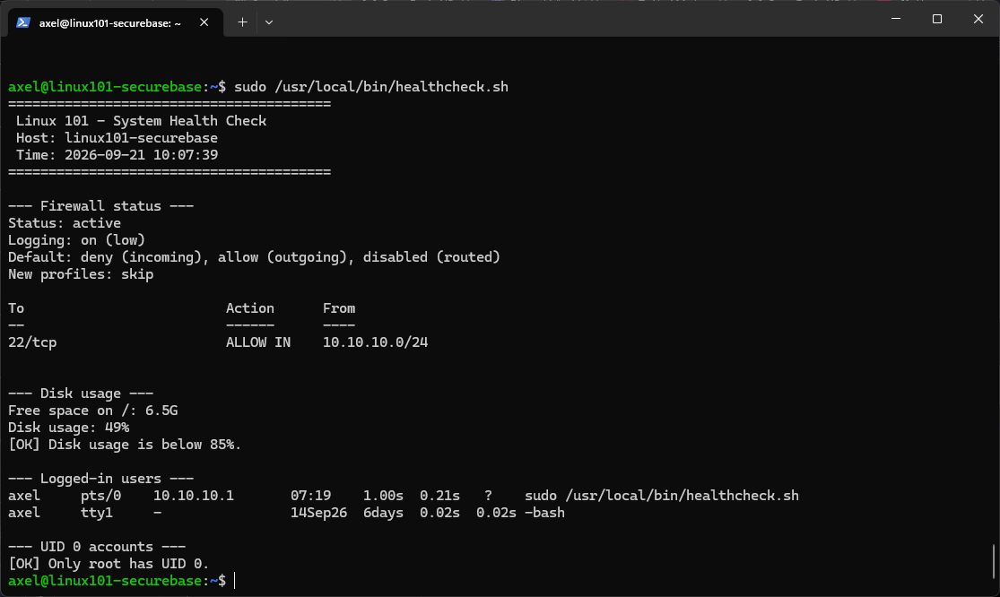
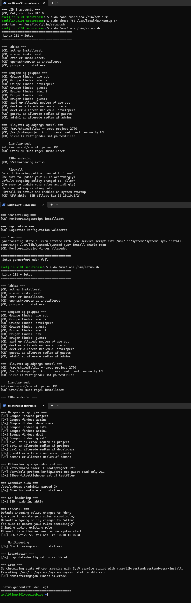

# Modul 6: Shell og Bash-scripting

## Formål

Formålet med modulet er at samle og automatisere centrale dele af Linux 101-konfigurationen, så opsætningen bliver reproducerbar, lettere at kontrollere og sikker at køre igen.

Der er lavet to scripts:

- `setup.sh` — automatiserer størstedelen af serverkonfigurationen fra modul 1-5
- `healthcheck.sh` — udfører et selvstændigt sikkerheds- og driftscheck af serveren

Begge scripts bruger funktioner, variable, betingelser og fejlhåndtering med `set -euo pipefail`.

## Udførte opgaver

### 1. setup.sh

`setup.sh` automatiserer følgende dele af serveropsætningen:

- kontrol og installation af nødvendige pakker
- oprettelse af grupper og brugere
- gruppemedlemskaber
- projektmapper og filrettigheder
- ACL til read-only gæsteadgang
- granulær sudo-regel til `admin1`
- SSH-hardening
- UFW-firewall
- monitoreringsscript
- monitoreringslog
- logrotate-konfiguration
- cron-job til monitorering

Scriptet ligger i denne mappe som:

`setup.sh`

På serveren blev det installeret som:

```text
/usr/local/bin/setup.sh
```

og gjort eksekverbart med:

```bash
sudo chmod 750 /usr/local/bin/setup.sh
```

Inden første kørsel blev Bash-syntaksen kontrolleret:

```bash
sudo bash -n /usr/local/bin/setup.sh
```

Scriptet køres med:

```bash
sudo /usr/local/bin/setup.sh
```

### 2. Idempotens

Scriptet er lavet, så det kan køres flere gange uden at oprette dubletbrugere, dubletgrupper eller gentagne cron-regler.

Eksempler på kontroller:

```bash
getent group "$group"
id "$user"
id -nG "$user"
```

Cron-jobbet tilføjes kun, hvis den præcise regel ikke allerede findes:

```bash
if crontab -l 2>/dev/null | grep -Fqx "$cron_line"; then
    echo "[OK] Monitoreringsjob findes allerede."
else
    ...
fi
```

Ved anden kørsel viste output blandt andet:

```text
[OK] Gruppe findes: project
[OK] Bruger findes: admin1
[OK] dev1 er allerede medlem af developers
Skipping adding existing rule
[OK] Monitoreringsjob findes allerede.
Setup gennemført uden fejl
```

Det viser, at en ny kørsel efterlader systemet i samme ønskede sluttilstand uden at skabe dubletter.

Nogle konfigurationsfiler skrives bevidst igen ved hver kørsel. Det gælder blandt andet SSH-hardening, sudoers-reglen, logrotate og monitoreringsscriptet. Dette er stadig idempotent, fordi indholdet og den ønskede sluttilstand er den samme efter hver kørsel.

### 3. SSH-sikkerhed i automatiseringen

SSH-hardening slår kun password-login fra, hvis den primære bruger allerede har en ikke-tom `authorized_keys`:

```bash
if [[ -s "$authorized_keys" ]]; then
    ...
else
    echo "[SKIP] Ingen authorized_keys fundet ..."
fi
```

Det reducerer risikoen for, at automatiseringen låser administratoren ude af serveren.

### 4. healthcheck.sh

`healthcheck.sh` udfører følgende kontroller:

- firewall-status
- ledig diskplads og diskforbrug
- aktive bruger-sessioner
- kontrol for andre UID 0-konti end `root`

Scriptet ligger i denne mappe som:

`healthcheck.sh`

På serveren blev det installeret som:

```text
/usr/local/bin/healthcheck.sh
```

og køres med:

```bash
sudo /usr/local/bin/healthcheck.sh
```

Eksempel på output:

```text
--- Firewall status ---
Status: active
Default: deny (incoming), allow (outgoing), disabled (routed)

22/tcp                     ALLOW IN    10.10.10.0/24

--- Disk usage ---
Free space on /: 6.5G
Disk usage: 49%
[OK] Disk usage is below 85%.

--- Logged-in users ---
axel     pts/0    10.10.10.1
axel     tty1     -

--- UID 0 accounts ---
[OK] Only root has UID 0.
```

### 5. Funktioner og fejlhåndtering

Scripts er opdelt i funktioner for at gøre dem lettere at læse og vedligeholde.

Eksempler fra `setup.sh`:

```bash
ensure_packages
configure_users_and_groups
configure_filesystem
configure_sudo
configure_ssh
configure_firewall
configure_monitoring
configure_logrotate
configure_cron
```

Eksempler fra `healthcheck.sh`:

```bash
check_firewall
check_disk
check_users
check_uid0
```

Begge scripts starter med:

```bash
set -euo pipefail
```

Dette gør blandt andet, at scriptet stopper ved fejl, reagerer på udefinerede variable og ikke skjuler fejl i pipelines.

## Sikkerhedsmæssig begrundelse

Automatisering reducerer risikoen for manuelle fejl og gør det lettere at reproducere den samme hærdede konfiguration på en ny server.

Idempotens er vigtig, fordi et administrationsscript ofte skal kunne køres igen efter ændringer eller fejlsøgning. En ny kørsel må derfor ikke skabe dubletkonfiguration eller gradvist ændre systemet i en uforudset retning.

`healthcheck.sh` samler flere grundlæggende sikkerheds- og driftskontroller i én kommando. Firewall-status, diskforbrug, aktive sessioner og UID 0-konti er alle relevante indikatorer ved almindelig drift og ved fejlsøgning eller hændelseshåndtering.

## Dokumentation / bevis

### Healthcheck

`healthcheck-output.png`

Viser et gennemført healthcheck med:

- aktiv UFW
- SSH kun tilladt fra management-subnettet
- diskforbrug under threshold
- aktive bruger-sessioner
- kun `root` med UID 0



### Idempotent setup

`setup-idempotent-second-run.png`

Viser gentagen kørsel af `setup.sh`, hvor eksisterende brugere, grupper, memberships, firewallregel og cron-job genkendes uden dubletter eller fejl.



## Overvejelser og fravalg

Hyper-V-opsætning og Netplan-konfiguration er ikke automatiseret i `setup.sh`.

Hyper-V-delen ligger uden for Linux-gæstesystemet, og netværksinterfaces kan variere mellem installationer. Automatisk overskrivning af Netplan uden først at kende det konkrete miljø kunne desuden afbryde netværks- og SSH-adgang.

Derfor automatiserer scriptet de dele, som sikkert og reproducerbart kan håndteres inde fra Linux-serveren.
